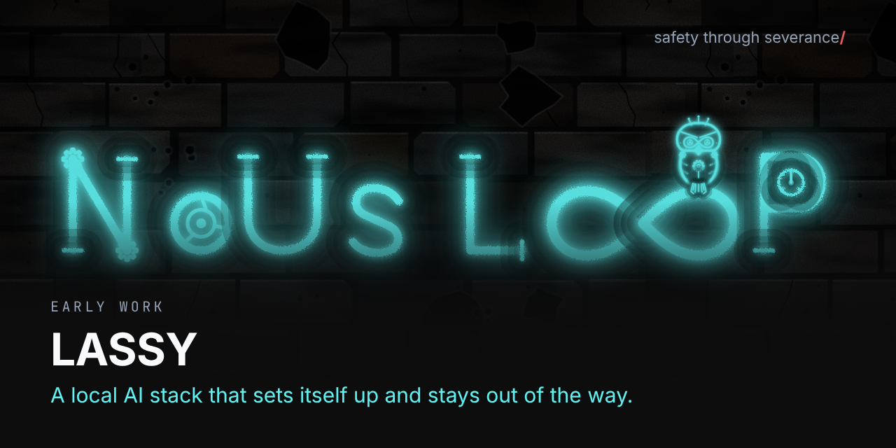

# LASSY

A local AI stack that sets itself up and stays out of the way. LASSY is part of NoUs Loop, which builds calm, private tools for neurodivergent minds that run on your own devices.

**Status:** early. The design is in progress and there's nothing to install yet. Watch this repo for the first release.

## What it will do

- Install and configure local language models and their supporting services on your own machine.
- Check that everything is healthy, and repair common problems without making you dig through logs.
- Keep everything on your device by default, with no accounts and no telemetry.

## Run it

Not yet available.

## Privacy

LASSY is local-first. Your prompts, files and models stay on your machine. Nothing is sent anywhere unless you turn it on.

## Contributing and security

Ideas and questions are welcome as issues. To report a security problem, contact the maintainers privately through GitHub (@nousloopsolutions) rather than opening a public issue.

## License

Not yet chosen. Until a license is added, all rights are reserved.
